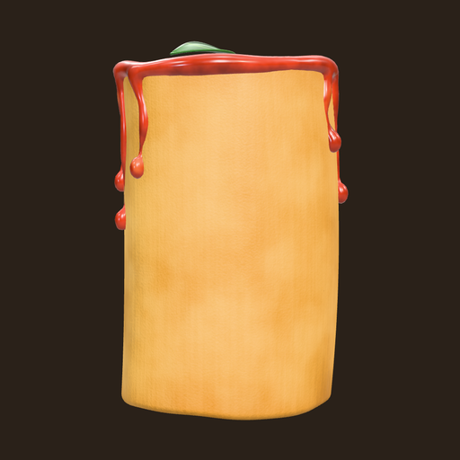
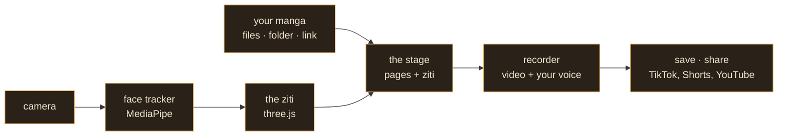

# ZitiCam Nippon

**Read manga on camera. The pages and your live-face ziti, recorded together in one take.**

Open a chapter, put the noodle where you want it, hit record, and talk. The video you stop is the video you post.

### [Open ZitiCam Nippon](https://bkd-ziti.github.io/Ziticam-Nippon/)

---

## why this exists

A manga review used to mean three things: a screen recording of the pages, a separate ziti clip on a key color, and hours in an editor lining the two up, page by page, cut by cut.

That's hours spent on assembly instead of on the part people actually come for: your take on the story.

Nippon removes the assembly. You read, you react, you turn pages, and everything lands in one finished video. The ziti sits wherever you put it, at whatever size, and you can move it mid-take when a panel needs the room. Pause between pages, resume without a seam. When you stop, it's ready to post.

## the ZitiCam family

| | what it's for | where it runs |
| --- | --- | --- |
| **ZitiCam** | the live-face ziti as a stream overlay | the stream PC, in OBS |
| **[ZitiCam Pocket](https://github.com/BKD-ziti/ziticam-pocket)** | the ziti on a key color, to drop over any clip | your phone |
| **ZitiCam Nippon** | manga reviews, pages and ziti in one take | phone or PC, online or off |

Same noodle, same tracking, same tuning across all three. Your ziti looks like your ziti wherever you film.

## the ziti on its plate

The ziti isn't a floating noodle anymore. It's one noodle popping up out of a plate of ziti: a low bed of pasta tossed in sauce, with basil and parmesan, on a glazed plate with a gold rim. Your real eyes and mouth sit up near the sauce at the top; right under the mouth it softens into a neck; below that the body carries on down into the pasta.

It's rigged like a face-tracked puppet: the head is pinned to your face, and everything below it follows on springs.

| you | the ziti |
| --- | --- |
| move your head side to side | the noodle leans from the plate to follow, a beat late, and settles |
| sit up / slouch | it slides up out of the pasta / sinks back in |
| lean in | it bends toward the camera |
| turn or tilt your head | the head turns with you; the body twists and tilts part of the way |
| talk | the head squashes with your jaw and the whole noodle bobs with your voice |

The head never lags: it's the part people read. The springs are all below the neck, which is where the life comes from. **Look → Body follow** sets how much the body copies the head's turn, **Look → Wobble** how springy it is.

**Layout → Style** switches between **On the plate** and **Classic**, the original floating noodle. Classic is the lighter of the two, handy on an older phone; each device remembers its own choice, so your phone can stay on Classic while your PC keeps the plate.

The plate is built in code when the app opens: no extra download, and it works offline like everything else.

## how it works

The ziti is drawn on a transparent layer and placed straight onto the page, so there's no key color to clean up. What you see on the stage is exactly what gets recorded. The buttons, the dashed ziti frame and the menus never appear in the video.

## make a review

1. Open the link. Tap **Start camera** and allow camera + mic.
2. Tap **Open manga**. Pick files, a folder, or paste a link.
3. Place the ziti. Drag it, pinch it (or pull the gold dot), or snap it to a corner in **Layout**.
4. Look at the camera and tap **Look → Set straight** so the noodle faces forward when you do.
5. Tap the red button. Read, react, turn pages.
6. Need a moment? Tap **pause**, line up the next page, resume. No gap in the video.
7. Tap stop. Watch it back, then **Save / Share**.

> **Make it an app.** On iPhone, tap **Share → Add to Home Screen**. On a PC, Chrome and Edge offer **Install** in the address bar. Either way it opens full screen, and after the first visit it works without internet.

## picking a shape

| shape | best for | how it lays out |
| --- | --- | --- |
| **9:16** | TikTok, Shorts, Reels | the page fills the top, the ziti lives in the space below |
| **16:9** | YouTube | the page sits left, the ziti gets the whole right side |
| **1:1** | feed posts | the page in the middle, the ziti tucked in a corner |

Each shape remembers its own ziti spot and size, so switching back and forth doesn't undo your setup.

| size | frame rate | best for | roughly |
| --- | --- | --- | --- |
| **720p** | 30 / 60 | older phones, long takes | 39 / 57 MB a minute |
| **1080p** | 30 / 60 | everyday posting; the safe default | 61 / 91 MB a minute |
| **4K** | 30 / 60 | YouTube, on a recent iPhone or a PC | 151 / 226 MB a minute |

**60 fps** makes page turns, zooms and the ziti's movement noticeably smoother. **4K** gives YouTube more to work with and keeps text crisp after compression, but a page can only be as sharp as its scan: a 1,500-pixel scan won't gain detail at 4K. PDFs are rendered at higher resolution automatically when 4K is on.

Layout shows the exact size and a per-minute estimate for whatever you pick. If the device can't keep up, Nippon tells you once and suggests the next step down, rather than quietly recording stutter.

## what it opens

| source | how |
| --- | --- |
| **Images** | JPG, PNG, WebP, AVIF, GIF (HEIC on iPhone). Pick several at once; they sort by page number, so `2.jpg` comes before `10.jpg`. |
| **Folder** | a chapter folder on a PC, or drag the folder onto the window. |
| **CBZ / ZIP** | the usual chapter archive. Best option on iPhone. |
| **PDF** | each page is rendered sharp for 1080p. |
| **Links** | direct image links (one per line), a `.cbz` / `.zip` / `.pdf` link, a numbered range like `https://…/ch1/{01-24}.jpg`, or a gallery page with images on it. |

CBR / RAR can't be opened in a browser; re-save as CBZ.

**About links:** many manga sites block other apps from loading their images. When a site does, Nippon says so plainly instead of failing quietly. Save the chapter and use **Files**. Everything you open stays on your device.

Nippon remembers the page you stopped on in each title, and picks up there next time.

## controls

| on the stage | |
| --- | --- |
| tap the left / right side | turn the page (direction follows **Manga ←** or **Comic →**) |
| swipe | turn the page |
| tap the middle | hide or show the controls, for a clean screen |
| pinch the page | zoom into a panel; drag to pan |
| drag the ziti | move it, even while recording |
| pinch the ziti / pull the gold dot | resize it |
| tap the page number | jump to any page |

Tall pages (webtoons, or **Fit → Width**) scroll down before they turn.

| on a PC | |
| --- | --- |
| `←` `→` | turn pages |
| `Space` / `↓` | next (scrolls tall pages first) |
| `R` | record / stop |
| `P` | pause / resume |
| `H` | hide controls |
| `Z` | ziti on / off |
| `O` | open manga |
| scroll over the ziti | resize it |
| `Ctrl` + scroll | zoom the page |
| drop files or a folder | open them |
| paste a link | open it |

**Layout** holds the ziti size, corner presets, a backdrop (circle or card, in gold, paper, ink or tomato), reading direction, page fit, where the page sits, the page-turn style (slide or cut), the background behind the page (ink or paper), and the video shape and size.

**Look** is the ziti itself, the same controls as Pocket: Set straight, eye and mouth size and placement, head follow, drift, talk bounce, calm, body follow, wobble, ziti size inside its frame, plate, sauce, eyebrows, flip, mirror, the 3-2-1 countdown, and Clean / Voice mic. **Reset to stream look** brings back the stream PC's tuning.

## tips for a better review

- **Read ahead, record reactions.** Skim the chapter once, then record. Your first reaction is valuable, but knowing what's coming lets you build to the big page.
- **Give the art room.** On a splash page, shrink the ziti or slide it to a corner. On a dialogue-heavy page, let it take more space and do the talking.
- **Pause, don't stop.** One paused take is one file to post. Five stopped takes are five files to stitch back together.
- **Zoom with intent.** Pinch into the panel you're talking about. Viewers follow your attention.
- **Hide the controls** (tap the middle, or `H`) when you want a clean screen to read from. They never show in the video either way.

## keeping it smooth, up to 4K at 60 fps

Nippon is built so a recent phone can record 4K at 60 fps:

- **The face tracker runs in the background,** so the page only has to draw and record each frame.
- **The plate's shadows are worked out once, when it's built.** Nothing on the plate moves relative to the light, so the pasta's shadows on itself and on the glaze are baked into its colors instead of being redrawn every frame; only the noodle's own shadow is live, and it's a few lines of math per pixel rather than a shadow map. That cut the plate's drawing cost almost in half; it now costs a little more than the classic noodle, not three times as much.
- **Only the ziti is anti-aliased.** The page is a flat rectangle and doesn't need it, so a 4K frame costs a fraction of what it would.
- **It stays smooth on its own.** If the phone can't keep up, Nippon first redraws the noodle every other frame (the face is only measured 30 times a second anyway, and pages, zooms, page turns and the ziti's box all still move at the full 60), then draws it a little softer, so the video keeps its frame rate instead of stuttering. At 30 fps the noodle is always redrawn every frame; only its sharpness gives way. Every step is checked: if it doesn't actually help, it's undone and the ziti stays at full quality. It steps back up when there's room.
- **The file is a true constant frame rate.** Every frame the stage draws goes straight to the phone's hardware video encoder, stamped at exactly 1/30 (or 1/60) of a second apart. If the phone hiccups and misses a beat, that beat is filled with the current picture instead of being left out, so a 30 fps setting gives a 30 fps file, in sync with your voice.
- **Takes save straight to the phone's storage** as you record, so a long 4K take never has to fit in memory.

If it still dips:

- **Step down one notch:** 4K at 30 fps, or 1080p at 60, looks close to 4K 60 on most screens and is half the work.
- **Turn off Low Power Mode** (iPhone: Settings → Battery). It slows the screen and the graphics chip.
- **Keep the phone cool and plugged in** for long takes. A hot phone slows itself down.
- **Close other apps and tabs,** especially anything else using the camera.
- **Check how it's recording:** open the app with `?debug=1`. The *recorder* line says **WebCodecs** when takes are constant frame rate; on older iPhones (before iOS 26) it says *built-in recorder*, which keeps every frame drawn but can't fill hiccups. *frames · repeated* shows how many beats had to be filled.
- **Run the performance check:** open the app with `?bench=1` (or `?bench=60`), tap **Start camera**, and keep the tab in front for about a minute. It runs the stage at 720p, 1080p and 4K with a moving, talking ziti and shows, for each size, whether it holds the frame rate, the lowest second, and how far the smoothness ladder had to step. Run it on each device you film with.
- **Check where the time goes:** in the same stats, *frame work* is what each frame costs the page; it should sit well under the *budget* (33 ms at 30 fps, 16 ms at 60). *smoothness step* shows whether Nippon is easing off the ziti. *tracked* is how often the face is read; if that's low while *render* holds 30, the video stays smooth and only the face updates less often.

## good to know

- **Leaving the app mid-take:** on iPhone, switching apps finishes the take so it isn't lost. On a PC, switching tabs pauses it; come back and resume.
- **The mic meter:** while you record, a small green bar next to the timer moves with your voice. If it moves, your voice is in the take. If no sound reaches the mic for a few seconds, Nippon tells you.
- **Best audio on iPhone:** in Safari, tap **aA → Website Settings** and set **Microphone** to **Allow**. Nippon can then close the mic between takes, so playback sounds the way it was recorded instead of thin and "on a call".
- **Long takes:** takes save straight to this device's storage as you record, so length isn't limited by memory, only by free space. The timer shows the file size as you go, and Layout shows the MB per minute. Paused time takes no space. (A browser that can't write to storage holds takes in memory instead; Layout says so.)
- **The last take** stays available (top right) until you delete it or record a new one, even if you close the app. If the app is closed or crashes mid-take on iPhone, everything up to that second is kept and shows up as the last take next time.
- **Offline:** after one visit with a connection, the whole app, the ziti and the face tracker open with no signal. Manga you open from files works offline too; links need a connection.
- **Privacy:** your camera feed, your face, your manga and your takes never leave your device. There's no account, no server and no tracking.

## if something's off

| what you see | try this |
| --- | --- |
| "Camera access is blocked" | allow Camera and Microphone for this site in your browser settings, then reload |
| the noodle doesn't follow your head | face the camera with even light, then **Look → Set straight** |
| a link won't open | the site blocks outside apps; save the chapter and use **Files** |
| a take is silent | allow the microphone for this site; watch the green mic meter next to the timer while recording |
| playback sounds thin or garbled on iPhone | set **Microphone** to **Allow** for this site (**aA → Website Settings**), so the mic can close before playback |
| "The mic was interrupted" | another app or a call grabbed the mic; Nippon reconnects it, and the take keeps going with a short gap |
| it feels slow, or a warning says frames are dropping | step down in **Layout**: 4K → 1080p, then 60 → 30 fps, then 720p. Close other apps and tabs |
| "couldn't record at that size" | that browser's video encoder doesn't support the setting; use 1080p or 30 fps |
| the saved video has fewer frames per second than you set | update to iOS 26 or later; Nippon then records at a constant frame rate. On older versions it records every frame the phone manages to draw |
| settings don't stick | private / incognito windows don't keep settings; use a normal window |

<b>URL flags for testing</b>

| flag | effect |
| --- | --- |
| `?manga=<link>` | open a chapter straight away |
| `?debug=1` | stats on from the start, including per-frame cost |
| `?bench=1` / `?bench=60` | the performance check: every recording size at 30 (or 60) fps, with a pass or fail for each |
| `?autostart=1` | skip the start screen |
| `?notrack=1` | run without the face tracker |
| `?track=page` | run the face tracker on the page instead of in the background |
| `?memrec=1` | hold takes in memory instead of writing them to storage |
| `?rec=mr` | record with the browser's built-in recorder instead of WebCodecs |
| `?mime=video/mp4` | force a recorder format |
| `?mp=<url>` | load MediaPipe from another location |

## under the hood

- **Face tracking:** Google MediaPipe Face Landmarker 0.10.35, bundled with the site so it works offline, with the CDN as a fallback. 478 face points plus a jaw-open score. It runs in a background worker, so a slow face check never delays a video frame; each answer comes back with the exact camera frame it measured, so the eyes and mouth stay lined up. Browsers that can't run it in the background run it on the page, as before.
- **The noodle:** three.js r169 rendering `ziti.glb` onto a transparent canvas, tuned identically to ZitiCam Pocket. On the plate it's a skinned mesh with three bones (body, neck, head), shaped from the same model in code: the head is the modeled noodle untouched, the lower part is stretched into the neck and body, and the sauce drips are shortened so they stay on the head. The head bone is set straight from the face tracker; the body bone is driven by damped springs that aim it at the head from its base in the plate; the neck sits halfway between in position and turn so it bends evenly.
- **The plate:** built at load in `ziti-plate.js`. Small ziti are dropped onto the plate one at a time and come to rest on whatever's already there (a height map keeps track), so they settle like real pasta; the ones buried under the sauce aren't drawn at all. The sauce is poured over that exact layer, then basil, tomato, herbs and parmesan go on top. The pasta's shadows are marched over the same height map once and baked into its colors; the noodle's own shadow on the plate is a soft capsule worked out per pixel from where it is, so there's no shadow map to draw.
- **The stage:** pages, backdrop and ziti are drawn together on the GPU, 30 or 60 times a second, at 720p, 1080p or 4K. The ziti renders into its own 4x anti-aliased image sized to its box, which is kept between frames, so moving the ziti never redraws it; the full frame isn't anti-aliased, which is most of the saving at 4K. The noodle applies three.js's Neutral tone curve itself, so it looks exactly as before. Each page is uploaded to the GPU once, before its page turn starts, so turns don't hitch either. The recorder captures that canvas plus your mic: H.264 MP4 where the browser supports it (Safari, Chrome), asking for the H.264 level each size needs (4.0 up to 5.2 for 4K60), and WebM where MP4 isn't available.
- **Recording:** with WebCodecs (iOS 26+, recent Chrome and Edge), each drawn frame is captured from the GPU right after it's drawn and handed to the hardware H.264 encoder with an exact timestamp; [Mediabunny](https://mediabunny.dev) writes the MP4 (fragmented, so it survives a crash). Audio is captured on the audio thread by an AudioWorklet, so busy drawing can never cause gaps, and is timestamped by sample count. Where WebCodecs can't record with sound, the browser's built-in recorder is used, handed exactly one frame per drawn frame.
- **Audio:** the recorder records one steady audio line, and the mic plugs into it. If the device interrupts the mic mid-take, the take gets a moment of silence instead of a broken audio track, and the mic is reconnected. The camera is never restarted during a take, since that can cut the mic on iPhone.
- **Manga:** JSZip for CBZ / ZIP and pdf.js for PDF, both bundled. Pages decode a few at a time, so a 200-page volume doesn't run a phone out of memory.
- **No build step:** plain HTML, CSS and JavaScript. GitHub Pages serves it exactly as it sits in this repo.

## files

| file | what it is |
| --- | --- |
| `index.html` | the screen: stage, buttons, sheets |
| `app.js` | the stage, page turning, gestures, recording |
| `stage.js` | draws the page, backdrop and ziti together on the GPU |
| `tracker-worker.js` | the face tracker, running in the background |
| `take-writer.js` | saves takes to this device's storage as they record |
| `recorder-wc.js` | constant-frame-rate recording with WebCodecs |
| `audio-tap.js` | captures the mic on the audio thread for recording |
| `vendor/mediabunny.min.mjs` | writes the MP4 file |
| `ziti.js` | the live-face ziti (shared design with Pocket) |
| `ziti-rig.js` | the head, neck and body, and how they move (identical in Pocket) |
| `ziti-plate.js` | the plate of ziti the noodle pops out of (identical in Pocket) |
| `perf-check.js` | the `?bench=1` performance check (identical in Pocket) |
| `reader.js` | opening files, folders, archives, PDFs and links |
| `sw.js` | offline support |
| `ziti.glb` | the 3D ziti (v2, sauce + basil) |
| `face_landmarker.task`, `vendor/mediapipe/` | the face tracker |
| `vendor/jszip.min.js`, `vendor/pdf*.js` | CBZ / ZIP and PDF readers |
| `three.module.min.js`, `GLTFLoader.js`, `RoomEnvironment.js`, `BufferGeometryUtils.js` | three.js r169 |
| `manifest.webmanifest`, `icon-180.png`, `icon-512.png` | home-screen app setup |

Run it locally with any static server, e.g. `python3 -m http.server`, then open `http://localhost:8000`.

## what's next

- [x] **v0.1:** manga + ziti in one take, live ziti placement, pause, works offline
- [x] **v0.2:** 4K output and 60 fps
- [x] **v0.3:** smooth ziti moves mid-take, reliable audio, live mic meter
- [x] **v0.4:** face tracking in the background, for a steady 30 fps while recording
- [x] **v0.5:** 4K 60 on phones: ziti-only anti-aliasing, a self-adjusting smoothness ladder, takes saved straight to storage and kept after a crash
- [x] **v0.6:** constant-frame-rate recording: the file gets every frame at exactly 30 or 60 fps, with gapless audio
- [x] **v0.7:** the ziti gets a head, neck and body, and pops up out of a plate of ziti that moves with you
- [x] **v0.7.1:** the plate at half the cost, a Plate / Classic switch in Layout, and a built-in performance check
- [ ] chapter markers: tap as you record, get timestamps for the video description
- [ ] intro and outro cards with the series title, in BKDziti styling
- [ ] spotlight: dim everything but the panel you're talking about
- [ ] two-page spreads side by side in 16:9
- [ ] teleprompter notes only you can see, never in the video

## credits

- [three.js](https://threejs.org), MIT license (`licenses/three.js-LICENSE.txt`)
- [MediaPipe](https://ai.google.dev/edge/mediapipe), Apache 2.0 (`licenses/mediapipe-NOTICE.txt`)
- [JSZip](https://stuk.github.io/jszip/), MIT (`licenses/jszip-LICENSE.md`)
- [pdf.js](https://mozilla.github.io/pdf.js/), Apache 2.0 (`licenses/pdf.js-LICENSE.txt`)
- [Mediabunny](https://mediabunny.dev) 1.65.2, unmodified, MPL 2.0 (`licenses/mediabunny-LICENSE.txt`)
- The ziti, its sauce and its basil: © BKDziti LLC

Manga you open belongs to its creators and publishers. Nippon is a reader and a recorder; it doesn't host or share anyone's work. Support the series you review.

 
a <b>BKDziti</b> experiment · rethinking food, media, and interaction, online and in person

