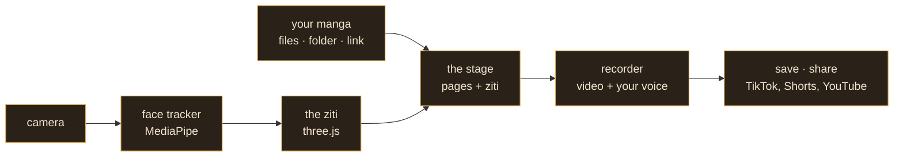

# ZitiCam Nippon

**Read manga on camera. The pages and your live-face ziti, recorded together in one take.**

Open a chapter, put the noodle where you want it, hit record, and talk. The video you stop is the video you post.

### [Open ZitiCam Nippon](https://bkd-ziti.github.io/Ziticam-Nippon/)

---

## why this exists

A manga review used to mean three things: a screen recording of the pages, a separate ziti clip on a key color, and hours in an editor lining the two up, page by page, cut by cut.

That's hours spent on assembly instead of on the part people actually come for: your take on the story.

Nippon removes the assembly. You read, you react, you turn pages, and everything lands in one finished video. The ziti sits wherever you put it, at whatever size, and you can move it mid-take when a panel needs the room. Pause between pages, resume without a seam. When you stop, it's ready to post.

## the ZitiCam family

| | what it's for | where it runs |
| --- | --- | --- |
| **ZitiCam** | the live-face ziti as a stream overlay | the stream PC, in OBS |
| **[ZitiCam Pocket](https://github.com/BKD-ziti/ziticam-pocket)** | the ziti on a key color, to drop over any clip | your phone |
| **ZitiCam Nippon** | manga reviews, pages and ziti in one take | phone or PC, online or off |

Same noodle, same tracking, same tuning across all three. Your ziti looks like your ziti wherever you film.

## how it works

The ziti is drawn on a transparent layer and placed straight onto the page, so there's no key color to clean up. What you see on the stage is exactly what gets recorded. The buttons, the dashed ziti frame and the menus never appear in the video.

## make a review

1. Open the link. Tap **Start camera** and allow camera + mic.
2. Tap **Open manga**. Pick files, a folder, or paste a link.
3. Place the ziti. Drag it, pinch it (or pull the gold dot), or snap it to a corner in **Layout**.
4. Look at the camera and tap **Look → Set straight** so the noodle faces forward when you do.
5. Tap the red button. Read, react, turn pages.
6. Need a moment? Tap **pause**, line up the next page, resume. No gap in the video.
7. Tap stop. Watch it back, then **Save / Share**.

> **Make it an app.** On iPhone, tap **Share → Add to Home Screen**. On a PC, Chrome and Edge offer **Install** in the address bar. Either way it opens full screen, and after the first visit it works without internet.

## picking a shape

| shape | best for | how it lays out |
| --- | --- | --- |
| **9:16** | TikTok, Shorts, Reels | the page fills the top, the ziti lives in the space below |
| **16:9** | YouTube | the page sits left, the ziti gets the whole right side |
| **1:1** | feed posts | the page in the middle, the ziti tucked in a corner |

Each shape remembers its own ziti spot and size, so switching back and forth doesn't undo your setup. Record at **1080p** for posting, **720p** if an older phone runs warm.

## what it opens

| source | how |
| --- | --- |
| **Images** | JPG, PNG, WebP, AVIF, GIF (HEIC on iPhone). Pick several at once; they sort by page number, so `2.jpg` comes before `10.jpg`. |
| **Folder** | a chapter folder on a PC, or drag the folder onto the window. |
| **CBZ / ZIP** | the usual chapter archive. Best option on iPhone. |
| **PDF** | each page is rendered sharp for 1080p. |
| **Links** | direct image links (one per line), a `.cbz` / `.zip` / `.pdf` link, a numbered range like `https://…/ch1/{01-24}.jpg`, or a gallery page with images on it. |

CBR / RAR can't be opened in a browser; re-save as CBZ.

**About links:** many manga sites block other apps from loading their images. When a site does, Nippon says so plainly instead of failing quietly. Save the chapter and use **Files**. Everything you open stays on your device.

Nippon remembers the page you stopped on in each title, and picks up there next time.

## controls

| on the stage | |
| --- | --- |
| tap the left / right side | turn the page (direction follows **Manga ←** or **Comic →**) |
| swipe | turn the page |
| tap the middle | hide or show the controls, for a clean screen |
| pinch the page | zoom into a panel; drag to pan |
| drag the ziti | move it, even while recording |
| pinch the ziti / pull the gold dot | resize it |
| tap the page number | jump to any page |

Tall pages (webtoons, or **Fit → Width**) scroll down before they turn.

| on a PC | |
| --- | --- |
| `←` `→` | turn pages |
| `Space` / `↓` | next (scrolls tall pages first) |
| `R` | record / stop |
| `P` | pause / resume |
| `H` | hide controls |
| `Z` | ziti on / off |
| `O` | open manga |
| scroll over the ziti | resize it |
| `Ctrl` + scroll | zoom the page |
| drop files or a folder | open them |
| paste a link | open it |

**Layout** holds the ziti size, corner presets, a backdrop (circle or card, in gold, paper, ink or tomato), reading direction, page fit, where the page sits, the page-turn style (slide or cut), the background behind the page (ink or paper), and the video shape and size.

**Look** is the ziti itself, the same controls as Pocket: Set straight, eye and mouth size and placement, head follow, drift, talk bounce, calm, ziti size inside its frame, sauce, eyebrows, flip, mirror, the 3-2-1 countdown, and Clean / Voice mic. **Reset to stream look** brings back the stream PC's tuning.

## tips for a better review

- **Read ahead, record reactions.** Skim the chapter once, then record. Your first reaction is valuable, but knowing what's coming lets you build to the big page.
- **Give the art room.** On a splash page, shrink the ziti or slide it to a corner. On a dialogue-heavy page, let it take more space and do the talking.
- **Pause, don't stop.** One paused take is one file to post. Five stopped takes are five files to stitch back together.
- **Zoom with intent.** Pinch into the panel you're talking about. Viewers follow your attention.
- **Hide the controls** (tap the middle, or `H`) when you want a clean screen to read from. They never show in the video either way.

## good to know

- **Leaving the app mid-take:** on iPhone, switching apps finishes the take so it isn't lost. On a PC, switching tabs pauses it; come back and resume.
- **Long takes:** the timer shows the file size as you go. Takes live in memory until you save them, so on a phone, save every 20 to 30 minutes of recording. Paused time takes no space.
- **The last take** stays available (top right) until you delete it or record a new one.
- **Offline:** after one visit with a connection, the whole app, the ziti and the face tracker open with no signal. Manga you open from files works offline too; links need a connection.
- **Privacy:** your camera feed, your face, your manga and your takes never leave your device. There's no account, no server and no tracking.

## if something's off

| what you see | try this |
| --- | --- |
| "Camera access is blocked" | allow Camera and Microphone for this site in your browser settings, then reload |
| the noodle doesn't follow your head | face the camera with even light, then **Look → Set straight** |
| a link won't open | the site blocks outside apps; save the chapter and use **Files** |
| a take is silent | allow the microphone for this site; the app warns you when it's off |
| it feels slow | switch to **720p** in **Layout**, or close other apps and tabs |
| settings don't stick | private / incognito windows don't keep settings; use a normal window |

<b>URL flags for testing</b>

| flag | effect |
| --- | --- |
| `?manga=<link>` | open a chapter straight away |
| `?debug=1` | stats on from the start |
| `?autostart=1` | skip the start screen |
| `?notrack=1` | run without the face tracker |
| `?mime=video/mp4` | force a recorder format |
| `?mp=<url>` | load MediaPipe from another location |

## under the hood

- **Face tracking:** Google MediaPipe Face Landmarker 0.10.35, bundled with the site so it works offline, with the CDN as a fallback. 478 face points plus a jaw-open score, every frame.
- **The noodle:** three.js r169 rendering `ziti.glb` onto a transparent canvas, tuned identically to ZitiCam Pocket.
- **The stage:** a single canvas composites the page and the ziti 30 times a second. The recorder captures that canvas plus your mic: H.264 MP4 where the browser supports it (Safari, Chrome), WebM where it doesn't.
- **Manga:** JSZip for CBZ / ZIP and pdf.js for PDF, both bundled. Pages decode a few at a time, so a 200-page volume doesn't run a phone out of memory.
- **No build step:** plain HTML, CSS and JavaScript. GitHub Pages serves it exactly as it sits in this repo.

## files

| file | what it is |
| --- | --- |
| `index.html` | the screen: stage, buttons, sheets |
| `app.js` | the stage, page turning, gestures, recording |
| `ziti.js` | the live-face ziti (shared design with Pocket) |
| `reader.js` | opening files, folders, archives, PDFs and links |
| `sw.js` | offline support |
| `ziti.glb` | the 3D ziti (v2, sauce + basil) |
| `face_landmarker.task`, `vendor/mediapipe/` | the face tracker |
| `vendor/jszip.min.js`, `vendor/pdf*.js` | CBZ / ZIP and PDF readers |
| `three.module.min.js`, `GLTFLoader.js`, `RoomEnvironment.js`, `BufferGeometryUtils.js` | three.js r169 |
| `manifest.webmanifest`, `icon-180.png`, `icon-512.png` | home-screen app setup |

Run it locally with any static server, e.g. `python3 -m http.server`, then open `http://localhost:8000`.

## what's next

- [x] **v0.1:** manga + ziti in one take, live ziti placement, pause, works offline
- [ ] chapter markers: tap as you record, get timestamps for the video description
- [ ] intro and outro cards with the series title, in BKDziti styling
- [ ] spotlight: dim everything but the panel you're talking about
- [ ] two-page spreads side by side in 16:9
- [ ] teleprompter notes only you can see, never in the video

## credits

- [three.js](https://threejs.org), MIT license (`licenses/three.js-LICENSE.txt`)
- [MediaPipe](https://ai.google.dev/edge/mediapipe), Apache 2.0 (`licenses/mediapipe-NOTICE.txt`)
- [JSZip](https://stuk.github.io/jszip/), MIT (`licenses/jszip-LICENSE.md`)
- [pdf.js](https://mozilla.github.io/pdf.js/), Apache 2.0 (`licenses/pdf.js-LICENSE.txt`)
- The ziti, its sauce and its basil: © BKDziti LLC

Manga you open belongs to its creators and publishers. Nippon is a reader and a recorder; it doesn't host or share anyone's work. Support the series you review.

 
a <b>BKDziti</b> experiment · rethinking food, media, and interaction, online and in person

